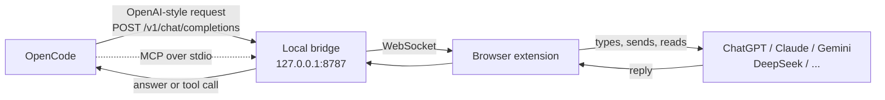

<div align="center">


# NOAPI?

**Use ChatGPT, Claude, Gemini, DeepSeek, Z.ai (GLM) and friends inside [OpenCode](https://opencode.ai), with no API keys.**

Your browser is already logged in. NOAPI? just lets OpenCode talk to it.

<br>


<a href="https://github.com/datnguyentien2006/noapi-td/actions/workflows/ci.yml"></a>

<br>

[Quick start](#-quick-start) &nbsp;•&nbsp;
[How it works](#-how-it-works) &nbsp;•&nbsp;
[Any project folder](#-use-it-from-any-project-folder) &nbsp;•&nbsp;
[Consult mode](#-consult-mode-use-a-normal-model--a-web-ai-as-advisor) &nbsp;•&nbsp;
[Troubleshooting](#-troubleshooting) &nbsp;•&nbsp;
[Limitations](#-honest-limitations)

</div>

<br>

## 💡 Why this exists

API access costs money, and a lot of us already pay for a chat subscription that we barely squeeze the value out of. NOAPI? connects the two. OpenCode sends a prompt, a small browser extension types it into the real chat page you have open, waits for the answer, and hands it back.

It is not magic and it is not an official integration. It is a careful bit of plumbing that works well enough that you can run a real coding agent on top of it, including file edits and shell commands.

<br>

## ✨ What you get

<table>
  <tr>
    <td width="50%" valign="top">

**🧰 Real tool use**<br>
`bash`, `read`, `write`, `edit` and the rest of OpenCode's tools work. The bridge teaches the website model a tiny text protocol and turns its replies into proper tool calls.

  </td>
    <td width="50%" valign="top">

**🧠 Live "Thinking" status and streaming**<br>
While the site works, OpenCode shows what is going on: typing, sending, waiting, then the answer streams in as the site writes it. Finished tool calls are handed over right away.

  </td>
  </tr>
  <tr>
    <td valign="top">

**🤖 Fully automatic**<br>
No copy and paste, no confirm button. Prompts are typed, sent and captured on their own. Only the assistant's reply goes back, not the whole page.

  </td>
    <td valign="top">

**🔌 Two ways to use it**<br>
Pick a browser model straight from `/models`, or keep your favourite model and let it ask a website through the MCP tool.

  </td>
  </tr>
  <tr>
    <td valign="top">

**🛡️ Built to survive real sites**<br>
Pages that refuse, chats that grow too long, replies that get cut off and tabs that fall asleep are all handled instead of ending the turn.

  </td>
    <td valign="top">

**🔒 Local only, zero dependencies**<br>
Plain Node.js 18+, no `npm install`, no build step. Everything stays on `127.0.0.1` in your own logged-in session.

  </td>
  </tr>
</table>

<br>

## 🌐 Supported sites

| | Site | Model id in OpenCode | Address |
|:-:|---|---|---|
| <picture><source media="(prefers-color-scheme: dark)" srcset="https://cdn.simpleicons.org/openai/white"></picture> | **ChatGPT** | `noapi/chatgpt` | chatgpt.com |
| <picture><source media="(prefers-color-scheme: dark)" srcset="https://cdn.simpleicons.org/claude/white"></picture> | **Claude** | `noapi/claude` | claude.ai |
| <picture><source media="(prefers-color-scheme: dark)" srcset="https://cdn.simpleicons.org/googlegemini/white"></picture> | **Gemini** | `noapi/gemini` | gemini.google.com |
| <picture><source media="(prefers-color-scheme: dark)" srcset="https://cdn.simpleicons.org/deepseek/white"></picture> | **DeepSeek** | `noapi/deepseek` | chat.deepseek.com |
| <picture><source media="(prefers-color-scheme: dark)" srcset="https://cdn.simpleicons.org/perplexity/white"></picture> | **Perplexity** | `noapi/perplexity` | perplexity.ai |
| <picture><source media="(prefers-color-scheme: dark)" srcset="https://cdn.simpleicons.org/xai/white"></picture> | **Grok** | `noapi/grok` | grok.com |
| <picture><source media="(prefers-color-scheme: dark)" srcset="https://cdn.simpleicons.org/mistralai/white"></picture> | **Mistral** | `noapi/mistral` | chat.mistral.ai |
| 🤖 | **Z.ai** | `noapi/zai` | chat.z.ai |

You need to be logged in, and the site has to be open in a tab. If you open several, each one can serve its own model.

> 🆕 **Z.ai (`noapi/zai`)** is supported here. The page renders every code block with a CodeMirror editor instead of `<pre>`, so the extension re-emits those blocks as fenced code (that is what keeps tool calls working) and skips the collapsed *Thought Process* panel so reasoning never leaks into the reply. Its square stop control has no `id`/`aria-label`, so it is matched by class rather than `:has()` — which keeps Firefox 115 working too.

<br>

## 🚀 Quick start

**You need:** Node.js 18 or newer, Chrome (or Edge, Brave, Opera, Arc) or Firefox, and OpenCode.

### 1️⃣ Load the extension

<details open>
<summary><b>Chrome, Edge, Brave, Opera, Arc</b></summary>

1. Open `chrome://extensions`
2. Turn on **Developer mode** (top right)
3. Click **Load unpacked**
4. Pick the `extension/chrome` folder

</details>

<details>
<summary><b>Firefox</b></summary>

1. Open `about:debugging#/runtime/this-firefox`
2. Click **Load Temporary Add-on...**
3. Pick `extension/firefox/manifest.json`

Firefox forgets temporary add-ons when it closes, so you will repeat this after a restart.

</details>

The Chrome extension asks for the `storage`, `power` and `alarms` permissions (Firefox needs only `storage`). `power` and `alarms` are only used to stop the browser from discarding your AI tabs and to keep the service worker awake while a reply is in flight; if you deny them, everything still works, just without that protection (see [keeping the tabs alive](#keeping-the-tabs-alive)).

### 2️⃣ Start the bridge

```bash
npm start
```

Leave it running. You can peek at the dashboard any time at **http://127.0.0.1:8787/**.

### 3️⃣ Open an AI site

Open one of the [supported sites](#-supported-sites) and log in. You will see a small round **`?`** button in the bottom right corner.

| Dot color | Meaning |
|:-:|---|
| 🟢 | Connected to the bridge, ready |
| 🟡 | Busy, a prompt is being handled |
| 🔴 | The bridge is not running |

### 4️⃣ Use it in OpenCode

Run `opencode` inside this folder, type `/models`, search for **NOAPI?** and pick something like `noapi/chatgpt`. Then just work as usual.

> 💬 Try: *"make a folder named test and put a hello.txt inside it"*. If everything is wired up, you will see the status lines scroll by and the files show up on disk.

<br>

## 📁 Use it from any project folder

The `opencode.json` in this repo only applies when you launch OpenCode from this exact folder. To use NOAPI? in all your projects, register it once in your global OpenCode config:

```bash
npm run install-global
```

That adds the `noapi` provider and the MCP server to `~/.config/opencode/opencode.json`, using the absolute path of this folder. Your other settings are kept, and a backup is saved next to the file as `opencode.json.bak`.

Then, for each project:

```bash
# terminal 1, inside the NOAPI? folder
npm start

# terminal 2, inside your project
opencode
```

A few things worth knowing:

- Start the bridge **before** OpenCode. If OpenCode has to start it for you and you close that session, other sessions lose the model.
- If you move the NOAPI? folder, run `npm run install-global` again.
- To undo it, run `npm run install-global -- --remove`.

<br>

## 🧩 How it works



In plain words:

1. OpenCode thinks it is talking to an OpenAI compatible server. That server is the **bridge**, a tiny Node program on your machine.
2. The bridge forwards the prompt over a WebSocket to the **extension**.
3. The extension finds the chat box on the open tab, types the prompt, presses send, and watches the page while the answer grows. The reply is complete once the site's stop button disappears and the text has settled briefly.
4. The answer streams back as it is written. When tools are enabled and the model finishes a `TOOL_CALL` block, the extension hands it over immediately and stops the site, instead of waiting for any trailing narration.

### 🧰 How tools work on a website that has no tools

Chat websites do not accept tool definitions, so the bridge improvises:

1. On the first prompt of a conversation it adds a short briefing that lists the available tools, the format for calling them, and an example that batches several independent calls into one reply.
2. When the model wants to act, it writes fenced blocks starting with `TOOL_CALL`, each followed by a small JSON object. Independent calls are requested together, so one round trip can do the work of several.
3. The bridge cuts those blocks out of the reply and hands OpenCode real `tool_calls`. A finished block is returned as soon as it settles, without waiting for the rest of the reply.
4. OpenCode runs the tools and sends the results back, which the bridge pastes into the chat as the next message.

Because the website already remembers the conversation, only the **new** message is sent each turn, not the whole history. Very long tool output is trimmed in the middle (16,000 characters by default; set `NOAPI_MAX_TOOL_RESULT` to change it), and the truncation marker tells the model how many characters were cut and how to re-run the tool for the missing part, so prompts stay sane without losing context silently.

#### RAW BLOCKS — large text without JSON escaping

File contents, edit text and long commands are what break hand-written JSON. Instead of escaping megabytes of text inside a JSON string, the model can put any multi-line argument in a **raw block** right after the JSON:

```text
TOOL_CALL
{"name":"write","arguments":{"filePath":"app.py"}}
<<<content
print("hello")
# exactly as it must appear — no JSON quotes, no \n escaping
content>>>
```

The bridge folds each `<<<argname ... argname>>>` block into the named string argument. The preamble teaches this whenever the tool set has a suitable string argument, and the repair prompts point back to it whenever JSON fails. A single call is kept to a sane size; for a big file the model is told to write the first part and then extend it with `edit` calls.

#### Refusal guard

Some pages have their own system prompt that says the model lives in a sandbox and cannot see your computer — so the model answers *"I cannot read `C:\NOAPI`; please upload the files"* instead of calling a tool. That reply has no `TOOL_CALL`, so without help it reached OpenCode as a final answer.

The guard (`bridge/guard.js`) fixes this in four layers, each switchable:

1. **Preamble override + worked example** — the briefing names the exact wrong answers and shows a full correct turn, because the page's own system prompt outranks a normal user turn. (`NOAPI_GUARD=0` removes it.)
2. **A one-line reminder** is appended to every real user turn, even when the preamble is not re-sent. (`NOAPI_REMIND=0`.)
3. **Detection + correction** — a reply with no tool call that matches a refusal (English, Vietnamese or Chinese, including the diacritic-folded wording) triggers up to two corrective follow-ups in the same chat. If the model still refuses, the turn **fails with a clear error** instead of silently returning prose. (`NOAPI_GUARD=0`.)
4. **Working-directory seed** (opt-in, `NOAPI_SEED_TREE=1`) — lists the real files in the first prompt so the model can see the bridge can reach the machine. Off by default because it sends local file names to the website.

The first `GUARD_HOLD` characters of a first-turn reply are also held back from the live stream while the text still reads like a refusal, so a refusal never flashes into OpenCode before the bridge has had a chance to correct it.

#### Repeat-call guard

Right after a chat rotation (or any context loss) the model can re-issue the exact call whose result it was just handed, and the agent loops. Two identical calls in a row are almost never intended, so the bridge asks once for the *next* step instead (`NOAPI_REPEAT_GUARD=0` disables it).

#### Chat rotation with a recap

A website chat gets slower and less reliable as it grows, and a big project does not fit in one. The bridge counts the characters exchanged with each chat; once the limit is passed in the middle of real work it opens a **new chat** and sends the tool protocol plus a compact **recap** built from OpenCode's own message list (no model call, so nothing can go wrong): the original task, later user messages, the files changed, the last thing the model said, and a shortened list of steps done so far. The newest tool results are sent right after it. If `PLAN.md` or `PROGRESS.md` exist in the working directory, the recap tells the model to read them and continue from them.

A rotation window never double-fires: rotation is skipped if the chat is too young (minimum turns), and the limit is raised automatically when the rotation prompt itself is a large slice of it (otherwise the new chat starts almost full and rotates again immediately).

#### When a reply is cut off

A long reply can stop mid-block. If the block is *truncated* (the reply does not end on its closing fence), the bridge asks the site to continue and **stitches** the pieces back together — up to three continuations, and only while the reply is still short enough to be worth continuing. If it truly cannot be recovered, the turn ends with an explicit error (and the raw reply is saved under `./noapi-debug/`) rather than handing a broken block to OpenCode as final text. `NOAPI_REPAIR_FAIL=text` restores the old "return it as plain text" behaviour.

### 🛡️ Small details that make it nicer

- 🚦 Requests to the same site are queued, so two prompts never collide in one chat box.
- ⏹️ Press <kbd>Esc</kbd> in OpenCode and the extension also hits the stop button on the website.
- 🔻 A turn that times out stops the site first, so the next send is not stuck waiting for a send button that never comes back.
- 🧯 A runaway reply (more than 40,000 characters with tools on) is cut short — a usable tool call never needs to be that long.
- 🔁 The extension reconnects on its own with exponential backoff, proves the link is alive with a ping/pong, and abandons a socket that stalls mid-handshake.
- 🏷️ OpenCode's session title requests are answered locally, so they do not clutter your real chat.
- 🖥️ The **Reconnect** button in the `?` panel reports the real outcome instead of guessing.
- 🌙 While an AI tab is open, the extension asks the browser not to discard the tab and (optionally) keeps the computer awake; timers run in a background Worker so a hidden tab still types and polls at full speed.

<br>

## ⚙️ Configuration

<details>
<summary><b>Manual setup in <code>opencode.json</code></b></summary>

If you prefer to edit the config by hand, this is what `npm run install-global` writes (replace the path with your own):

```json
{
  "$schema": "https://opencode.ai/config.json",
  "provider": {
    "noapi": {
      "npm": "@ai-sdk/openai-compatible",
      "name": "NOAPI? (browser bridge)",
      "options": {
        "baseURL": "http://127.0.0.1:8787/v1",
        "apiKey": "noapi-local"
      },
      "models": {
        "chatgpt":    { "name": "ChatGPT via browser",    "limit": { "context": 128000,  "output": 8192 } },
        "claude":     { "name": "Claude via browser",     "limit": { "context": 200000,  "output": 8192 } },
        "gemini":     { "name": "Gemini via browser",     "limit": { "context": 1000000, "output": 8192 } },
        "deepseek":   { "name": "DeepSeek via browser",   "limit": { "context": 128000,  "output": 8192 } },
        "perplexity": { "name": "Perplexity via browser", "limit": { "context": 100000,  "output": 8192 } },
        "grok":       { "name": "Grok via browser",       "limit": { "context": 128000,  "output": 8192 } },
        "mistral":    { "name": "Mistral via browser",    "limit": { "context": 128000,  "output": 8192 } },
        "zai":        { "name": "Z.ai via browser",       "limit": { "context": 128000,  "output": 8192 } }
      }
    }
  },
  "mcp": {
    "noapi": {
      "type": "local",
      "command": ["node", "/absolute/path/to/NOAPI/bridge/index.js", "--mcp"],
      "enabled": true,
      "timeout": 30000
    }
  }
}
```

The API key is a dummy value. Nothing checks it.

</details>

<details>
<summary><b>Bridge flags and endpoints</b></summary>

```bash
node bridge/index.js [--mcp] [--port=8787] [--host=127.0.0.1]
```

| Flag | What it does |
|---|---|
| `--port=8788` | Use another port. Update `baseURL` in your config to match. |
| `--host=...` | Bind address. Keep it on `127.0.0.1` unless you know why you are changing it. |
| `--mcp` | Also expose the MCP server on stdio. If the port is already taken by a running bridge, it switches to proxy mode and forwards to it. |

| Endpoint | Purpose |
|---|---|
| `GET /` | Status dashboard |
| `GET /health` | JSON status: clients, pending requests, sites, per-site counters, guard stats |
| `GET /v1/models` | One model per site |
| `POST /v1/chat/completions` | OpenAI compatible chat, streaming and non streaming |

The bridge treats `Ctrl+C` as "close the sockets and exit"; a second press more than a second later forces the exit. Without that the extension kept its socket open and stayed "connected" to a bridge that had already gone.

</details>

<details>
<summary><b>Fast-path flags (for A/B runs)</b></summary>

Every latency fast path can be turned off to compare a run with it on against a run with it off. Content-script flags live in the extension's storage and are toggled from the **`?` panel → Fast paths (A/B)**; they need no source edit and no reload. Bridge-side flags are environment variables read by `npm start` / `npm run mcp`. Every default equals the shipped behaviour.

| Flag | Where | Default | What it does |
|---|---|---|---|
| `observerDriven` | extension storage (panel) | on | Wake the completion loop on DOM events instead of polling every 400ms. Off = the old interval-only loop. |
| `eagerSend` | extension storage (panel) | on | Click Send the moment the site enables it instead of after a fixed 150ms. Off = the old fixed settle. |
| `sseObserver` | extension storage (panel) | on | Use the page's own SSE stream as a completion signal. Off = the DOM-only completion path. |
| `sseText` | extension storage (panel) | off | **Experimental.** Let the SSE observer decode the page's stream for an even earlier tool-call trigger. The reply text still comes from the DOM. Also needs `NOAPI_SSE_TEXT=1` on the bridge (the two are ANDed). |
| `NOAPI_SSE` | env (bridge) | on | Set to `0` to stop using the page's SSE stream for this bridge. The panel flag and this env var are ANDed. |
| `NOAPI_EARLY_RETURN` | env (bridge) | on | Set to `0` to disable the early return on a complete `TOOL_CALL` block **and** the stop click; the turn then falls back to normal completion detection. |
| `NOAPI_EARLY_RETURN_MS` | env (bridge) | `400` | Grace window after the last reply text before an early return is allowed. Clamped to 50–5000. |
| `NOAPI_TERSE` | env (bridge) | on | Set to `0` to drop the "terse output" rules from the tool preamble (no prose between tool calls, concise final answers). |
| `NOAPI_NEW_CHAT` | env (bridge) | off | Set to `1` to open a fresh chat for every new OpenCode conversation (see below). |
| `NOAPI_SSE_TEXT` | env (bridge) | off | Arms the stream-decoding path. ANDed with the panel `sseText` flag. |

</details>

<details>
<summary><b>Robustness flags (guard, repair, rotation, connections)</b></summary>

All are read by the bridge process at request time. Defaults are the shipped behaviour.

| Env var | Default | What it does |
|---|---|---|
| `NOAPI_GUARD` | on | Set to `0` to drop the refusal-guard preamble override, the worked example and the corrective follow-ups. |
| `NOAPI_REMIND` | on | Set to `0` to stop appending the one-line protocol reminder to a real user turn. |
| `NOAPI_SEED_TREE` | off | Set to `1` to list the working directory (names only, no secrets) in the first prompt. |
| `NOAPI_REPEAT_GUARD` | on | Set to `0` to accept two identical calls in a row instead of asking for the next step. |
| `NOAPI_TOOL_REPAIR` | on | Set to `0` to return a malformed `TOOL_CALL` block to OpenCode as plain text instead of asking the site to resend it. When on, a reply that carries a `TOOL_CALL` marker but no usable block triggers at most two short follow-ups; each attempt logs `tool repair: attempt N/2 reason=... tool=...`. A follow-up tells the tab which reply it is replacing, so a stale DOM read that hands the previous answer back verbatim is ignored (`tool repair: stale reply ignored (unchanged, N chars)`). |
| `NOAPI_REPAIR_FAIL` | error | What to do when a `TOOL_CALL` cannot be recovered even after repair. Default: end the turn with an error (so the agent does not mistake a broken block for a final answer). `text` restores the old behaviour of returning the raw reply. |
| `NOAPI_CONTINUE` | on | Set to `0` to stop continuing a reply that was cut off mid-block. Up to three continuations, only while the reply is still under 30,000 characters. |
| `NOAPI_CLIENT_WAIT_MS` | `15000` | When a request arrives before the extension has reconnected (MV3 backoff, alarms), hold it this long for a tab to appear instead of failing at once. `0` = fail immediately. Clamped to 0–120000. |
| `NOAPI_MAX_WS` | `256` | Cap on simultaneous WebSocket connections, so a client stuck in a reconnect loop cannot exhaust the bridge. |
| `NOAPI_MAX_PENDING_HELLO` | `32` | Cap on sockets that opened but have not introduced themselves yet. |
| `NOAPI_CANCEL_ACK_MS` | `5000` | How long a cancelled request waits for the tab to confirm it really stopped. |
| `NOAPI_HUB` | on | Set to `0` to stop the MCP server spawning your other configured MCP servers (see [MCP hub](#-mcp-hub)). |

**Chat rotation** (`bridge/rotation.js`, `bridge/recap.js`):

| Env var | Default | What it does |
|---|---|---|
| `NOAPI_ROTATE_CHARS` | `150000` | Characters sent + received in a chat before it is rotated. `0` turns rotation off. |
| `NOAPI_ROTATE_CHARS_<SITE>` | per site | Per-site override (e.g. `NOAPI_ROTATE_CHARS_ZAI=300000`). Z.ai ships with `300000`. A plain `NOAPI_ROTATE_CHARS` wins over the built-in per-site table. |
| `NOAPI_ROTATE_MIN_TURNS` | `3` | Never rotate twice within this many turns of the same chat. |
| `NOAPI_ROTATE_RESULT_BUDGET` | `24000` | Total characters of pending tool results allowed in a rotation prompt (the recap already carries the history). `0` = no compaction. |

</details>

<details>
<summary><b>Prompt-size knobs</b></summary>

| Env var | Default | What it does |
|---|---|---|
| `NOAPI_MAX_TOOL_RESULT` | `16000` | Characters of a tool result sent back to the site (head + tail). Truncation always says how much was cut. A lower value such as `6000`–`8000` shrinks every tool-result turn and can cut latency, at the cost of the model seeing less of a long output (re-run the tool with a narrower range for the rest). |
| `NOAPI_DESC_MAX` | `400` | Description cap for priority tools (edit, write, bash, read, patch-like, or any tool with an `oldString`/`newString`/`replace` parameter). Other tools stay at 180. |
| `NOAPI_PARAM_DESC_MAX` | `400` | Parameter-description cap for those same priority tools. Other tools stay at 90. |
| `NOAPI_DESC_MODE` | `full` | Set to `lean` to give even the priority tools the short caps, shrinking the preamble for the same tool set. Tool semantics are unchanged. |
| `NOAPI_TOOL_DENY` | empty | Comma-separated tool names to leave out of the preamble. They stay fully callable: the bridge validates a call against the request's tool list, not the rendered preamble. |
| `NOAPI_DUMP_PREAMBLE` | off | Set to `1` to write the exact prompt (preamble + first turn) sent to the site into `./noapi-preamble.txt` and log its length. |
| `NOAPI_STREAM` | on | Set to `0` to stop streaming live deltas and emit the reply once at the end (the old behaviour). |

Failed tool-call replies are also written to `./noapi-debug/` (one file per failure) so the real text can be inspected after the fact. The directory is created lazily on the first failure, keeps only the newest 20 files at up to 200 KB each, and holds the **raw reply only** — never the request prompt. A reply can still quote file contents from the conversation, so the directory is gitignored and should be treated as sensitive; delete it when you are done.

</details>

<details>
<summary><b>Timing knobs (for A/B runs)</b></summary>

Every timing constant the content script uses can be overridden per request without editing source, so you can measure a value before changing a default. The bridge reads each variable at request time and forwards it to the tab (a content script cannot read `process.env`). All values are clamped, and an unset, empty or invalid variable keeps the shipped default.

| Env var | Default | What it does | Range |
|---|---|---|---|
| `NOAPI_DEBOUNCE_MS` | per site (`350`–`550`) | How long the reply must be unchanged before the DOM path calls it complete. | 30–5000 |
| `NOAPI_SSE_END_REREAD_MS` | `120` | Re-read the reply node after the page's SSE stream closes, to catch a final paint. | 0–5000 |
| `NOAPI_EARLY_RETURN_REREAD_MS` | `120` | Re-read after the early-return stop click, so a block mid-write is not cut. | 0–5000 |
| `NOAPI_EXTRACT_THROTTLE_MS` | `120` | Minimum gap between DOM reads of the growing reply. | 10–5000 |
| `NOAPI_FALLBACK_TICK_MS` | `400` | Safety-net poll interval (shadow-DOM sites and the timeout/stop checks). | 50–10000 |
| `NOAPI_PARTIAL_THROTTLE_MS` | `150` | Minimum gap between live partials forwarded to OpenCode. | 20–5000 |
| `NOAPI_EARLY_RETURN_HARD_CAP_MS` | `1500` | Longest wait for a possible second tool block before stopping early. | 50–30000 |

</details>

### `NOAPI_NEW_CHAT=1` — a fresh chat per session

When a request starts a new OpenCode conversation (no assistant message yet), the extension clicks the site's *new chat* control before typing. The trade-off:

- **Faster pages** — a blank chat has a tiny DOM and no old context, so the site responds and paints sooner.
- **No pollution** — previous OpenCode sessions never bleed into the new one.
- **It changes your chat history** — the site keeps the old conversations, but your *current* tab moves to a blank chat each session, so the chat you were reading is left behind. That is why it is **off by default**.
- If no new-chat control is found, the turn continues in the current chat and says so in the status panel.

Only one fresh chat is opened per session (the first request); later turns in the same OpenCode conversation stay in that chat, because the request then has an assistant message. Automatic [chat rotation](#chat-rotation-with-a-recap) uses the same mechanism, but is driven by chat size instead.

### Keeping the tabs alive

`extension/chrome/keepalive.js` (loaded by the background script) does three small things, each guarded so a missing permission just disables that one:

1. Marks every AI tab `autoDiscardable: false`, so the browser's memory saver does not put your chat to sleep mid-task.
2. Keeps the computer awake while an AI tab is open (`power.requestKeepAwake`) — set `KEEP_AWAKE = false` at the top of the file to skip.
3. Wakes the background worker every 30 s with an alarm, so it and the bridge connection stay alive.

The content script also moves its timers into a dedicated Worker, because a hidden tab's `setTimeout` is throttled to roughly once a second and then to once a minute. The `?` panel's status and each reply's timing report `[NOAPI] timers run in a background Worker: true` when this is active; if a page's CSP blocks the Worker, everything falls back to the ordinary timers.

### Running an A/B comparison

`tools/ab-report.js` is a dependency-free Node script that turns `/health` timings into a per-site before/after table. It never talks to a website; it only reads the bridge's own counters.

1. **Capture the baseline.** With the fast paths at their defaults, drive the sites you care about for a few turns, then label the run:
   ```bash
   node tools/ab-report.js capture before
   ```
   Capture as often as you like — records are de-duplicated by request id and merged, so repeated captures accumulate. `ab-results/before.json` is gitignored.

2. **Flip one fast path and repeat.** Toggle it in the `?` panel → *Fast paths (A/B)* (no reload needed) or set the bridge env var and restart `npm start`:
   ```bash
   node tools/ab-report.js capture after
   ```

3. **Compare.**
   ```bash
   node tools/ab-report.js compare before after
   ```
   Prints, per site: request count, median and p90 of `firstText` / `complete` / `total`, and the share of each `completedBy` value (`sse`, `stop-button`, `fallback-2200`, `early-return`). Below 5 requests it says *too few samples to compare* instead of pretending.

Flip only **one** flag per pair so the table reflects that flag. `/health` keeps at least 50 recent requests per site, so a single capture covers a normal A/B pair; for a clean read, capture right after a run so old turns are not mixed in.

### Measuring latency in more detail

`tools/report-latency.js` reads the same `/health` counters and prints, per site, the **median and p90** of every stage, plus the median prompt size and the truncation canary. It needs a running bridge:

```bash
node tools/report-latency.js            # defaults to http://127.0.0.1:8787
node tools/report-latency.js http://127.0.0.1:8788 --json
```

Output covers `composer`, `typed`, `sent`, `firstText`, `lastToken`, `complete`, `postToken` (the client overhead *after* the model's last token — the number every fast path is chasing), `total`, the median `promptChars`, and `lateGrowth`. **`lateGrowth` must stay 0**: any other value means a completion fast path returned a reply that the page kept painting afterwards, i.e. the reply was truncated. The content script re-reads the last reply node ~1s after a turn and reports the growth, and the bridge logs and counts it per site.

`tools/prompt-report.js` measures the prompt the bridge sends, without a browser. It reads a tool-set fixture (a representative OpenCode set ships in `tools/fixtures/opencode-tools.json` — replace it with a captured real request body for exact numbers) and reports the full first-turn prompt length, the marginal preamble cost of each tool, what `NOAPI_DESC_MODE=lean` and `NOAPI_TOOL_DENY` save, and the characters the lossless tool-result cleanup removes:

```bash
node tools/prompt-report.js
```

### A manual real-site check

To sanity-check the tuning against the real ChatGPT page:

1. With the defaults, run **20 real turns** in one OpenCode session, then `node tools/report-latency.js` and note `postToken`, `total`, the median `promptChars` and `lateGrowth`.
2. Re-run with the tuned values, for example:
   ```bash
   NOAPI_EARLY_RETURN_MS=200 NOAPI_DEBOUNCE_MS=250 NOAPI_SSE_END_REREAD_MS=60 npm start
   ```
   Run another 20 turns and `node tools/report-latency.js` again.
3. Compare `postToken` and `total` per site. `lateGrowth` must still be 0 in both runs; if it is not, the faster value is cutting replies and should not be adopted.

<br>

## 🤝 Consult mode (use a normal model + a web AI as advisor)

Usually you let `noapi/*` **be** the model. Consult mode flips that around: keep
your normal model in charge (it has the good editor and the diffs) and use a
strong web model as an advisor for the hard parts — a nasty bug, a security
review, a large refactor. The `consult` MCP tool sends the files you name, plus
your question, to a site that is open and logged in in your browser, and brings
the answer back.

> 🔐 **Your file contents leave your machine.** Consult mode pastes the files you
> name straight into the website's chat box. It refuses `.env*`, `*.pem`,
> `*.key`, `id_rsa*`, anything under `.git/` or `node_modules/`, and anything
> over the size limit — but everything else you name **is sent**. Never point it
> at secrets.

### The `consult` tool

| Argument | Required | What it is |
|---|---|---|
| `question` | yes | What to ask about the files. |
| `files` | yes | 1..N paths relative to the workspace (an absolute path inside an allowed root also works), each optionally with a 1-based line range: `src/app.js:10-40`. |
| `site` | no | Which site (`chatgpt`, `claude`, `gemini`, `deepseek`, `perplexity`, `grok`, `mistral`, `zai`). Defaults to the first connected site. |
| `mode` | no | `patch` (default), `explain` or `review`. |
| `timeout_seconds` | no | How long to wait for the answer (default 180). |

- `explain` / `review` prefix every line with its line number and ask for plain
  analysis that references those numbers.
- `patch` asks for edit blocks in one fixed format:

  ```text
  ===== EDIT: <path> =====
  <<<<<<< SEARCH
  <exact existing lines, copied from the file>
  =======
  <replacement lines>
  >>>>>>> REPLACE
  ===== END EDIT =====
  ```

  When the reply comes back, the bridge checks each block's `SEARCH` text
  against the file on disk and appends a `--- consult validation ---` report
  with one line per block: `ok`, `SEARCH not found`, `SEARCH found N times`,
  `file not found or unreadable`, `SEARCH block is empty`, or `refused` (the
  path is outside the allowed roots or a secret). **It never writes to disk** —
  the model that called `consult` applies the blocks it trusts with its own
  `edit` tool, re-reading the file when a block does not match.

File contents are sent as plain text between `===== FILE: ... =====` markers,
with no markdown fences (chat pages tend to rewrite them).

### Consult configuration

| Env var | Default | What it does |
|---|---|---|
| `NOAPI_CONSULT_MAX_FILE` | `60000` | Max characters of a single file's included content. |
| `NOAPI_CONSULT_MAX_TOTAL` | `80000` | Max characters across all files. If exceeded, the error names each file's size so you can retry with a line range. |
| `NOAPI_CONSULT_ROOTS` | *(empty)* | Extra allowed directories. Separated by `;` (or `:`); a Windows drive path such as `C:\dir` is never split on its colon, so it works even when the bridge runs on Linux/macOS. The workspace (`cwd`) is always allowed. |
| `NOAPI_AUTOREAD` | off | **Optional, off by default.** Set to `1` to append the contents of the files named in the *latest* user message to a `noapi/*` request, so a model that cannot call `read` still sees the file. It attaches **once per task** — only when the newest message is that user turn, never on a `TOOL_RESULT` continuation, never from system/earlier turns, and never twice for the same file (paths in either slash style, and mixed drive-letter case, compare equal). Instruction files (`AGENTS.md`, `CLAUDE.md`, `opencode.json`) are not attached unless the latest message names them. Same secret/size rules as `consult`, and a leading UTF-8 BOM is stripped. Paths are matched by their own flavour (`C:\dir\f.py`, `C:/dir/f.py`, mixed case all agree). Each real candidate not attached gets its own `autoread skip <path>: <reason>` line; each request ends with a summary line `[noapi] autoread: attached N file(s), M chars, prompt total P chars`. |

### Pointing your primary agent at a non-NOAPI model

Keep the `noapi` MCP server enabled and set the default model to one that is
**not** from `noapi`. `model` is the verified config field (the `noapi` provider
and MCP blocks below are the same ones `npm run install-global` writes):

```json
{
  "$schema": "https://opencode.ai/config.json",
  "model": "anthropic/claude-sonnet-5-5",
  "provider": {
    "noapi": {
      "npm": "@ai-sdk/openai-compatible",
      "options": { "baseURL": "http://127.0.0.1:8787/v1", "apiKey": "noapi-local" },
      "models": {
        "chatgpt": { "name": "ChatGPT via browser (no API)" }
      }
    }
  },
  "mcp": {
    "noapi": {
      "type": "local",
      "command": ["node", "/absolute/path/to/NOAPI/bridge/index.js", "--mcp"],
      "enabled": true
    }
  }
}
```

The root `AGENTS.md` in this repo gives the model its instructions: for hard
analysis or large refactors, call the noapi `consult` tool with the relevant
files, then apply the returned edit blocks itself.

### One manual recipe

1. Start the bridge (`npm start`) and open, say, Claude or ChatGPT in a tab with
   the extension active.
2. In OpenCode, pick a **non-NOAPI** model and ask:
   *"Use the noapi consult tool on `bridge/consult.js` and `bridge/mcp.js` with
   mode `review`, tell me the riskiest bug, then fix it yourself."*
3. The model calls `consult`; the website answers with analysis or edit blocks;
   the model applies the edit with its own `edit` tool.

<br>

## 🧩 MCP hub

The `noapi` MCP server is a small **hub**: on start it reads your OpenCode config, spawns the *other* MCP servers you have enabled, and re-publishes their tools alongside its own `chat` / `consult` / `status` / `sites`. That way a session running on a `noapi/*` model still has your normal MCP tools available.

The hub refuses to start inside itself (`NOAPI_HUB_CHILD` is set for every child, so a server that lists itself can never fork-bomb), skips any entry whose command is this bridge (matched by its real path on disk, including Windows paths and array-style commands), honours `enabled: false`, and merges both `env` and `environment` for a child. Set `NOAPI_HUB=0` to turn the whole feature off.

<br>

## 🔧 Troubleshooting

| What you see | What to try |
|---|---|
| **"No browser tab on ... is connected"** | Open that site in a tab, make sure you are logged in, and check that the `?` button has a green dot. Refresh the tab if the extension was just reloaded. The bridge waits ~15 s for a reconnect before giving up (`NOAPI_CLIENT_WAIT_MS`). |
| **Red dot on the `?` button** | The bridge is not running. Start it with `npm start`, or click **Reconnect** in the `?` panel. |
| **Port 8787 already in use** | Run `node bridge/index.js --port=8788` and change `baseURL` in your config to `:8788/v1`. |
| **NOAPI? is missing from `/models`** | You are probably outside this folder. Run `npm run install-global` once. |
| **"The model refused to use tools ... even after 2 corrections"** | The site's own system prompt is winning. Open a NEW chat on that site, switch off its built-in tools (code execution / uploads), then send *"continue"*. Or try `NOAPI_SEED_TREE=1` so the model sees real paths. |
| **"TOOL_CALL ... could not be parsed ... even after auto-repair"** | The model produced unrecoverable JSON three times. Send *"continue"*; if it repeats, switch to a stronger model. Raw replies are in `./noapi-debug/`. |
| **Stuck at "Waiting for ... to answer"** | The site may have changed its layout. Open the `?` panel and read the last status line. The stall message includes a short technical summary you can paste into an issue. |
| **"Waiting for the browser extension to connect"** | The bridge started before the extension reconnected. It waits ~15 s; reload the tab if it persists. |
| **The prompt gets typed but never sent** | The extension retries a few times on its own. If it keeps failing, the send button selector for that site probably needs an update. |
| **It worked yesterday, today it does not** | Sites change their pages. See [Limitations](#-honest-limitations) and [Adding or fixing a site](#-adding-or-fixing-a-site). |
| **Firefox lost the extension** | Temporary add-ons disappear on restart. Load it again from `about:debugging`. |

> 🪪 **Tip:** keep the AI tab visible when you can. Browsers slow down background tabs; the extension works around this with a background Worker, but a visible tab is still the smoothest.

<br>

## 🧪 Testing without a browser

You can check the whole pipeline with a fake browser tab. No real site needed.

```bash
npm test
```

This starts a bridge, connects a fake extension, and runs plain requests, streaming content deltas, early return on tool calls (one and several blocks), MCP in both modes, and a full tool call round trip (model asks for `bash`, gets the result, answers). It also runs the pure logic lifted out of the content script, the `TOOL_CALL` protocol, the streaming safety filter, the bridge request queue, the security checks, site wiring, and a Playwright fallback test when a browser is installed.

The newer suites run standalone (they spawn their own bridges and never touch a real one):

```bash
node tools/test-guard.js        # refusal detection, the preamble override, the stream hold, seedTree
node tools/test-guard-e2e.js    # guard + rotation end to end through the bridge
node tools/test-background.mjs  # reconnect backoff, liveness, the Reconnect button
node tools/test-mcp-hub.mjs     # MCP hub self-detection and recursion guard
```

```bash
npm run bench
```

runs the same fake tab a few times and prints time-to-first-streamed-content and full round-trip numbers, so you can see whether a change actually made things faster.

Every test binds an OS-assigned ephemeral port (`--port=0`) and a second guard test checks that no test can reach the real bridge on 8787.

<br>

## 🗂️ Project layout

```text
NOAPI/
├── bridge/                 Local server (pure Node.js)
│   ├── index.js            Entry point, WebSocket + HTTP + MCP wiring, graceful shutdown
│   ├── http.js             OpenAI compatible endpoints and dashboard
│   ├── state.js            Request queue, routing, progress, cancel, chat usage
│   ├── toolproto.js        TOOL_CALL protocol: preamble, raw blocks, parsing, repair, continue
│   ├── guard.js            Refusal guard, reminder, seed tree, repeat-call guard
│   ├── recap.js            Compact handover for a rotated chat
│   ├── rotation.js         When to rotate a chat (limits, minimum turns)
│   ├── mcp.js              MCP server, hub for your other MCP servers, proxy mode
│   ├── consult.js          Consult mode: path rules, prompt + EDIT block logic
│   ├── streamfilter.js     Streaming safety filter (holds back refusal / partial blocks)
│   ├── tuning.js           Per-request timing overrides
│   ├── security.js         Origin checks for HTTP + WebSocket
│   ├── sites.js            Supported sites
│   └── ws.js / wsclient.js Minimal WebSocket server and client
├── extension/
│   ├── chrome/             Manifest V3 extension
│   │   ├── background.js   Connection, routing, reconnect watchdog
│   │   ├── content.js      Page logic: type, send, read, tool calls
│   │   ├── keepalive.js    Never-discard tabs, keep-awake, alarms
│   │   └── sse-observer.js MAIN-world stream observer
│   └── firefox/            Same site logic and selectors, Firefox manifest
├── tools/
│   ├── install-global.js   Register NOAPI? in your global OpenCode config
│   ├── fake-extension.js   Fake browser tab for tests
│   ├── bench-latency.js    Round-trip latency benchmark
│   ├── test-all.js         End to end tests
│   ├── lib/harness.js      Ephemeral-port test harness
│   ├── test-content-logic.js  Pure content-script logic
│   ├── test-toolproto.js   The TOOL_CALL protocol
│   ├── test-streamfilter.js   The streaming safety filter
│   ├── test-bridge-state.js   The bridge request queue
│   ├── test-guard.js       Refusal guard and its wiring
│   ├── test-guard-e2e.js   Guard + rotation through a real bridge
│   ├── test-background.mjs The extension connection manager
│   ├── test-mcp-hub.mjs    MCP hub self-detection
│   ├── test-isolation.js   Tests never touch the default port
│   ├── test-site-wiring.js A new site is registered everywhere
│   ├── test-consult.js     Consult mode unit + MCP integration tests
│   └── test-tools.js       Tool call round trip
├── opencode.json           Project level OpenCode config
└── AGENTS.md               Instructions for a non-NOAPI primary model
```

<br>

## 🤝 Adding or fixing a site

Sites change their HTML from time to time, so selectors rot. The good news is that each site is only a small block of config.

1. In `extension/chrome/content.js`, find the `SITES` object. Each entry lists CSS selectors for the **input**, the **send** button, the **stop** button and the **reply** messages.
2. Open the site, right click the element, choose Inspect, and update the selector.
3. Mirror the same block into `extension/firefox/content.js`.
4. For a brand new site, also add it to `bridge/sites.js` (and to the `SITE_ENUM` in `bridge/mcp.js`) and to `opencode.json`.
5. Add the origin to both manifests: `host_permissions`, the `matches` of **both** content-script entries (the DOM script and the MAIN-world SSE observer) and `web_accessible_resources`. Miss one and the site silently never connects.
6. Run `npm test` (`tools/test-site-wiring.js` checks every one of those spots), reload the extension, and try it on the real page.

A site that renders code with something other than `<pre>` (z.ai uses a CodeMirror editor) needs a small `extractText` branch so the code is re-emitted as a fenced block; the shared `codeFence` helper builds it and has unit tests.

Pull requests with selector fixes are very welcome. 🙏

<br>

## ⚠️ Honest limitations

I would rather tell you now than have you find out later.

- **It depends on page layouts.** There is no official interface here. When a site redesigns its chat page, that site can break until the selectors are updated.
- **Speed.** You are driving a real web page, so replies take as long as the website takes, plus a little overhead. The bridge streams the answer as it is written and returns finished tool calls immediately, but the site's own model time cannot be removed.
- **Tool quality varies by model.** Tool use works through a text format the model has to follow, including raw blocks for large text. Strong models do it reliably, weaker ones occasionally slip; the guard and repair loops recover the common cases, but a weak model can still refuse or emit unrecoverable JSON.
- **One conversation per site tab.** The website keeps the history, so a very long session may hit that site's own limits. The bridge rotates to a fresh chat with a recap before that happens, but rotation loses whatever detail did not fit in the recap.
- **The Chrome build is the most hardened.** Background-proof timers, tab keep-awake and the reconnect watchdog currently ship in `extension/chrome`; Firefox runs the same site logic and selectors, with the standard timers.
- **Free plans have limits too.** The websites still apply their own message caps and rules.
- **Terms of service.** Automating a website may go against that site's terms. This project is meant for personal use with your own account. You are responsible for how you use it, and it is not affiliated with OpenAI, Anthropic, Google, DeepSeek, Perplexity, xAI, Mistral, Z.ai or OpenCode.

<br>

## 🔐 Privacy and security

- 🏠 The bridge listens on `127.0.0.1` only. Nothing is exposed to your network.
- 🚫 No analytics, no tracking, no external servers.
- 🍪 The extension never reads or stores your passwords or cookies. It only types into and reads from the chat page you already opened.
- 🔒 To tell when an answer is finished, a small observer watches the page's *own* network calls. By default it never reads the response body — it only notes when the site's stream starts and ends. Only if you opt in to the experimental `sseText` flag (and `NOAPI_SSE_TEXT=1`) does it decode the stream inside your browser to notice a tool call slightly earlier. That text never leaves your machine, and the reply that is returned still comes from the page itself.
- 📂 By default **nothing** from your disk is sent to a site for you. `consult` sends only the files you explicitly name; `NOAPI_SEED_TREE=1` sends the *names* (not contents) of files in the working directory; `NOAPI_AUTOREAD=1` sends the contents of files named in the latest user message. All three are opt-in or explicitly driven.
- 👀 It is plain JavaScript with no build step, so what you read is what runs.

<br>

## 📄 License

NOAPI? is released under the [MIT License](LICENSE). Use it, change it, share it. Just keep the license notice.

<br>

<div align="center">

Made for people who like their tools local and their bills small. 💚

If NOAPI? saved you some money, a ⭐ on the repo is a nice way to say thanks.

</div>
